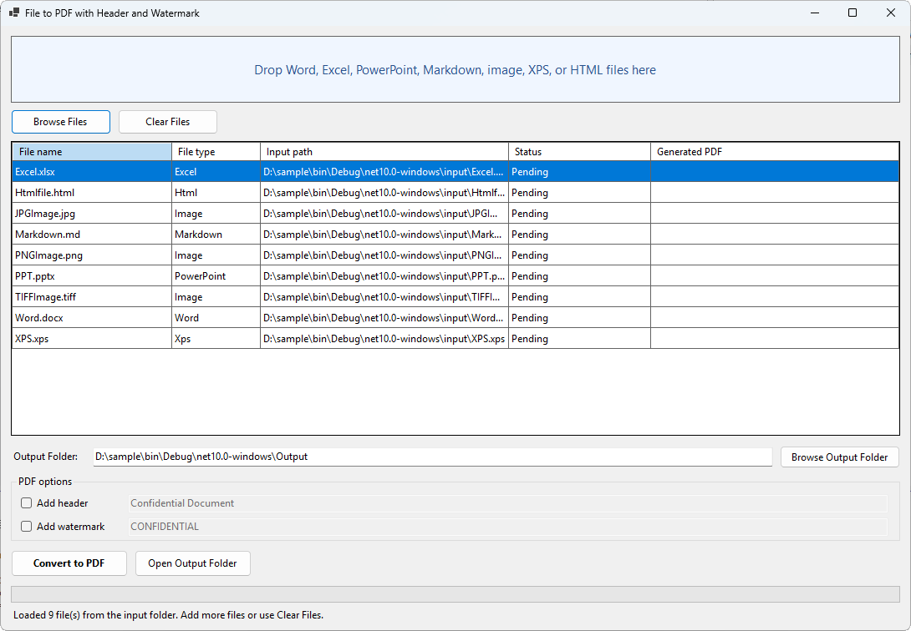

# File to PDF with Header and Watermark (VB.NET, Windows Forms)

## 1. Overview

A Windows Forms desktop sample, written entirely in VB.NET, that converts a batch of documents to PDF with the Syncfusion Document Processing libraries (Windows Forms packages). After conversion it can add a header and/or a diagonal watermark to every page. It does not need Microsoft Office or Adobe Acrobat.




## 2. Supported input formats

| Category   | Extensions                                    |
|------------|-----------------------------------------------|
| Word       | `.doc` `.docx` `.rtf`                         |
| Excel      | `.xls` `.xlsx`                                |
| PowerPoint | `.ppt` `.pptx`                                |
| Markdown   | `.md` `.markdown`                             |
| Images     | `.jpg` `.jpeg` `.png` `.bmp` `.tif` `.tiff`   |
| XPS        | `.xps`                                        |
| HTML       | `.html` `.htm`                                |

## 3. Prerequisites

- Windows 10 or 11 (x64).
- Visual Studio 2026 / 2022 17.14 or later (.NET 10 support) with the **.NET desktop development** workload, or the .NET 10 SDK or later for command-line builds.
- A Syncfusion license key (a free Community License or a trial key works). Without one, the app still runs but the PDFs carry a Syncfusion trial banner.

## 4. Visual Studio and .NET version

| Item             | Value                                              |
|------------------|----------------------------------------------------|
| Target framework | `net10.0-windows` (Windows Forms)                   |
| Language         | VB.NET |
| IDE              | Visual Studio with .NET 10 support (or `dotnet` CLI) |

The sample uses the Syncfusion `*.WinForms` packages listed on the [Syncfusion NuGet packages required](https://help.syncfusion.com/document-processing/pdf/pdf-library/net/nuget-packages-required) page. Those packages ship a `net10.0-windows7.0` build (alongside `net462`, `net8.0-windows7.0` and `net9.0-windows7.0`).

## 5. Syncfusion NuGet packages

All packages use the same version, defined once as `SyncfusionVersion` in the `.vbproj` (currently `35.1.41`). Keep them identical to avoid assembly conflicts.

| Purpose                                  | Package                                         |
|------------------------------------------|-------------------------------------------------|
| License registration                     | `Syncfusion.Licensing`                          |
| PDF creation, image to PDF, XPS to PDF   | `Syncfusion.Pdf.WinForms`                       |
| Word loading (also Markdown import)      | `Syncfusion.DocIO.WinForms`                     |
| Word and Markdown to PDF                 | `Syncfusion.DocToPdfConverter.WinForms`         |
| Excel loading                            | `Syncfusion.XlsIO.WinForms`                     |
| Excel to PDF                             | `Syncfusion.ExcelToPdfConverter.WinForms`       |
| PowerPoint loading                       | `Syncfusion.Presentation.WinForms`              |
| PowerPoint to PDF                        | `Syncfusion.PresentationToPdfConverter.WinForms`|
| HTML to PDF (Blink engine)               | `Syncfusion.HtmlToPdfConverter.WinForms`        |
| Markdown parsing (used by DocIO)         | `Syncfusion.Markdown`                           |

## 6. License registration

Open [Program.vb](Program.vb) and replace the placeholder:

```vb
Syncfusion.Licensing.SyncfusionLicenseProvider.RegisterLicense(
    "YOUR SYNCFUSION LICENSE KEY")
```

Use a key generated for the same Syncfusion version and platform (see the [Syncfusion license key generator](https://help.syncfusion.com/common/essential-studio/licensing/how-to-generate)).

## 7. Restore, build and run

Visual Studio: open `FileToPdfWithHeaderAndWatermark.sln`, then press **F5**. NuGet packages restore automatically.

Command line:

```powershell
dotnet restore
dotnet build -c Release
dotnet run -c Release
```

## 8. Adding files

**Default input files:** the [input](input) folder is copied next to the executable (`bin\Debug\net10.0-windows\input`) and every supported file in it is loaded into the list at startup. Put your own sample files there before building to change the defaults. You can add more files, or press **Clear Files** and add your own.

- **Drag and drop**: drag files from Explorer onto the drop panel (or the file list).
- **Browse Files**: opens a multi-select file dialog filtered to all supported extensions.

Both paths use the same code. Duplicate paths are ignored and unsupported extensions are reported in a message box. Pick an **Output Folder** (default: an `Output` folder next to the executable, for example `bin\Debug\net10.0-windows\Output`; it is created automatically if it does not exist), then press **Convert to PDF**. Each file shows its own status (Success or the failure reason) and the generated PDF path. If `Report.pdf` already exists, the new file is saved as `Report_1.pdf`, `Report_2.pdf` and so on. Existing PDFs are never overwritten. **Open Output Folder** shows the result in Explorer.

## 9. Header and watermark options

The two options are independent: use neither, either one, or both. The text boxes are enabled only while their check box is selected, and the text must not be empty.

- **Header** (default text `Confidential Document`): centered, 10 pt Helvetica, dark gray, in the top margin of every page, with a thin separator line below it. Width is computed from each page's real size, so portrait and landscape pages both work.
- **Watermark** (default text `CONFIDENTIAL`): large bold light-gray text, 30% opacity, rotated along the page diagonal and centered. The graphics state is saved before the rotation and restored afterwards. The font is scaled to the page size.

Both are applied *after* conversion by `PdfCustomizationService`, so every input format shares the same logic.

Notes:
- The header sits in the top margin. Content with no top margin (PowerPoint slides, full-bleed XPS or HTML) may touch the header.
- The text uses the Helvetica standard PDF font, which covers Latin characters only.

## 10. HTML converter runtime requirements

`Syncfusion.HtmlToPdfConverter.WinForms` renders with an embedded Chromium (Blink) engine.

- The package copies the Chromium binaries (`chrome.exe`, `chrome.dll` and related files) to `runtimes\win-x64\native` (and the x86 and ARM64 equivalents) next to the executable on build. **Deploy the whole `runtimes` folder with the app.**
- The target machine needs the **Visual C++ Redistributable (x64)**.
- Use a 64-bit process (the sample builds for AnyCPU on 64-bit Windows).
- Relative CSS, images and scripts resolve against the HTML file's folder, which is passed as the base URL. External `http(s)` resources need internet access.

## 12. Architecture

| File | Responsibility |
|------|----------------|
| [MainForm.vb](MainForm.vb), [MainForm.Designer.vb](MainForm.Designer.vb) | UI: drag-and-drop, file browsing, validation, progress, result display. Runs each conversion with `Task.Run` so the UI stays responsive. |
| [Services/DocumentConversionService.vb](Services/DocumentConversionService.vb) | Detects the format by extension and routes to `ConvertWordToPdf`, `ConvertExcelToPdf`, `ConvertPowerPointToPdf`, `ConvertMarkdownToPdf`, `ConvertImageToPdf`, `ConvertXpsToPdf` or `ConvertHtmlToPdf`. Also customizes, saves with a unique name and logs failures. |
| [Services/PdfCustomizationService.vb](Services/PdfCustomizationService.vb) | Draws the header and watermark on every page of a `PdfDocument`. |
| [Services/ConversionErrorLogger.vb](Services/ConversionErrorLogger.vb) | Appends detailed errors to `conversion-errors.log`. |
| [Models/ConversionOptions.vb](Models/ConversionOptions.vb) | Input path, output path, header and watermark settings. |
| [Models/ConversionResult.vb](Models/ConversionResult.vb) | Success flag, message and exception details for one file. |
| [Models/SupportedFileTypes.vb](Models/SupportedFileTypes.vb) | Extension to format mapping, shared by the UI and the service. |

Resource handling: input files are copied into a `MemoryStream`, so they are never left locked. Syncfusion documents, workbooks, presentations and renderers are disposed with `Using` blocks, and the generated `PdfDocument` is closed after saving.

## 13. Error handling and logging

Each file is processed independently, so one failure never stops the batch. The list shows a short reason. The full details (date, file path, format, message and stack trace) go to `conversion-errors.log` next to the executable. When the batch finishes, a summary shows the total, succeeded and failed counts and the output folder.
